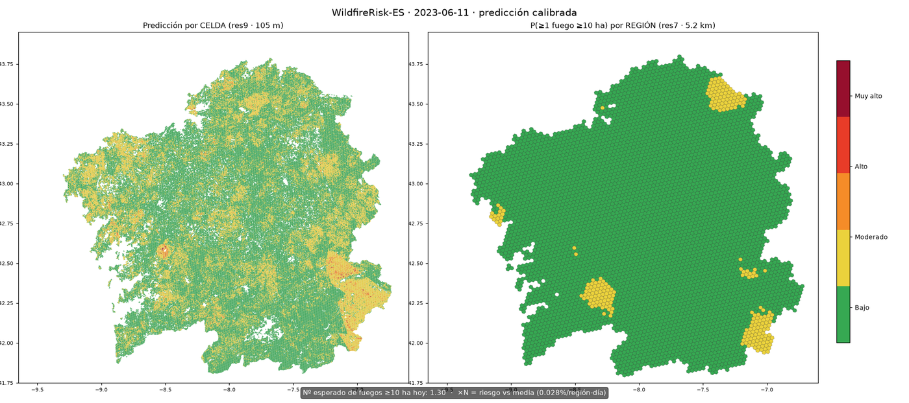

# WildfireRisk-ES (codename: Ardentia)

Sistema de evaluación predictiva y explicable del riesgo de ignición y propagación
de incendios forestales en España a escala de malla hexagonal H3 res9 (~105 m·celda),
con piloto en **Galicia** y despliegue final en **Cloudflare**.

> Documentación detallada en [`docs/`](docs/):
> - [PREPROCESSING.md](docs/PREPROCESSING.md) — pipeline de preprocesamiento completo (fuentes → features → modelo)
> - [EXPERIMENTS.md](docs/EXPERIMENTS.md) — diario de experimentos: adoptados y refutados con métricas
> - [DATA_MODEL.md](docs/DATA_MODEL.md) — organización del lake, features y etiquetas
> - [PIPELINES.md](docs/PIPELINES.md) — guía operativa: cómo regenerar el sistema desde cero
> - [SOURCES.md](docs/SOURCES.md) — fuentes de datos, rate limits y quirks

## Esencia del producto

Los índices convencionales (FWI) son meteorológicos y de baja resolución. Este sistema
integra **tres capas** que el FWI ignora:

1. **Estática territorial**: topografía (GLO-30), modelos de combustible Rothermel
   (MFE25, `n_MODCOM` 1–13 directamente disponible), y **factor antrópico** — red
   viaria (OSM/BTN25) con `dist_to_road`, `road_class`, `road_density_1km` y
   `road_fuel_interface` (vía cuyo arcén toca combustible denso).
2. **Dinámica biofísica**: NDMI/NDVI/NBR de Sentinel-2 vía **STAC earth-search (AWS, sin
   auth) con composites locales en GPU/CPU**; meteorología AEMET (tiempo real) + histórico
   oficial; ERA5-Land para humedad de suelo/VPD. propiedad: **sin GEE, sin API keys para
   datos satellite**.
3. **Explicabilidad**: TreeSHAP por celda + boletín operativos generado con LLM.

**Criterio de validación de la idea (Fase 2 Gate):** el modelo multinivél
*piloto* debe superar un baseline puro-FWI en **PR-AUC**, con ablations que
demuestren la ganancia específica de las variables viarias/antrópicas.
(Decisión 2026-10-29: los embeddings satelitales (AlphaEarth/Prithvi) quedan
**fuera del MVP**; la ablación se hace con met + índices espectrales + estáticas.)

## Quick start

```bash
uv sync && uv pip install osmium
cp .env.example .env   # rellenar claves (ver docs/SOURCES.md)
.venv/bin/python -m ardintra.ingest.bootstrap_data --sources egif,effis,dem,osm,mfe25
```

Pipelines independientes (`uv run python -m <módulo>`):

| Módulo | Qué hace |
|---|---|
| `ardintra.ingest.egif.parse_egif` | EGIF XML/zip → `parts_normalized.parquet` + QA |
| `ardintra.ingest.effis_wfs` | Perímetros RDII 2017–2025 vía WFS (sin auth) |
| `ardintra.ingest.dem_glo30` | Copernicus GLO-30 → mosaico + pendiente + orientación |
| `ardintra.ingest.osm_roads` | OSM pbf → `roads_driveable.parquet` (clases normalizadas) |
| `ardintra.ingest.mfe25` | MFE25 → SHP (con ModeloComb Rothermel por polígono) |
| `ardintra.ingest.aemet.aemet_obs` | AEMET obs horaria + estaciones (tiempo real) |
| `ardintra.ingest.openmeteo_daily` | Backfill histórico meteorológico (_checkpoint idempotente) — AEMET paced para estaciones missing |
| `ardintra.ingest.s2_stac` | Composites S2 LOCALES (NDMI/NDVI/NBR verano 2017–2024 @100 m, sin auth) |
| `ardintra.features.build_static` | Tabla maestra H3 res9 con todas las estáticas |

## Pipeline final validado (2026-10-31)

```
Forecast D-1 (HRES vía Open-Meteo, corrección NGR-lite por estación)
  → LGBM 48 features (245k celdas H3 res9)
  → calibración isotónica (Brier 0.0118→0.0065, reliability casi perfecta)
  → Stage 2 regional: GLM + Moran Eigenvector Maps res7 (Poisson jerárquico)
  → niveles de riesgo ×N + λ diario (Nº esperado de fuegos)
```

**Métricas clave** (splits temporales honestos, test 2023-24 jamás tocado):

| Métrica | Valor | Referencia |
|---|---|---|
| ROC-AUC agregado (muestra, obs) | 0.897 | LGBM 48 feats |
| ROC-AUC agregado (forecast D-1 corregido) | 0.887 | coste −1pp por operar con forecast |
| Recall operativo top-10% territorio | 29.5-31.2% | 82 días, 137 fuegos ≥10 ha |
| Recall operativo top-5% | 13-14% | idem |
| AUC regional (Stage 2 GLM+MEM, 2024) | **0.755** | vs 0.693 isotónica / 0.719 cruda |
| Recall@10% regiones-día (Stage 2) | **39.4%** | vs 27.3% baseline |
| Calibración celda (Brier) | 0.0065 | −45% vs crudo |
| Corrección NGR del forecast | RMSE FWI −22% | 3.03→2.37 |

**Vídeo de ejemplo** (`reports/simulacion_2023_2panel.mp4`, temporada 2023):
panel izquierdo = celdas res9 por percentil de riesgo calibrado; panel derecho =
P(≥1 fuego ≥10 ha) por región res7 con el modelo Stage 2, etiquetas ×N (riesgo
vs base rate) en las top-3 del día; pie con λ diario y fuegos reales (⭐ ≥10 ha).

## Webapp interactiva (predicción real por día)

```bash
uv run uvicorn ardintra.api.mini_api:app --port 8001
# abrir http://localhost:8001
```

El visor MapLibre integra el **sistema completo real**: elige una fecha →
"Predecir" → construye las 245.172 celdas de features (forecast D-1 del día,
satélite, recencia, viaria) → celda: P(ignición ≥10 ha) calibrada; región:
P(≥1 fuego ≥10 ha) (Stage 2 GLM+MEM); λ diario; y los fuegos reales de EGIF
de ese día como ⭐ para comparar.

- **Explicabilidad TreeSHAP**: click en cualquier celda con predicción activa →
  factores que suben/bajan su score (log-odds, valores originales).
  (`GET /v1/explain/{date}/{h9}`)
- **Boletín del día** (📋): λ, regiones destacadas ×N, factores globales del día
  (media |SHAP|) y comparación con los fuegos reales. Con `ANTHROPIC_API_KEY`
  en el entorno se genera en prosa operativa vía LLM; sin clave, resumen determinista.
- Endpoints: `GET /v1/forecast/{date}`, `GET /overlay/forecast/{date}.png`,
  `GET /v1/explain/{date}/{h9}`, `GET /v1/bulletin/{date}`.

## Visual

**Temporada 2023 con el sistema completo** (`reports/simulacion_2023_2panel.mp4`,
2 paneles: celdas res9 + regiones res7 con P(≥1) y etiquetas ×N; pie con λ diario
y fuegos reales ⭐):

| Día pico (12-oct-2023, 6 fuegos ≥10 ha) | Inicio de temporada |
|---|---|
|  |  |

Gráficas del ciclo: [curvas ROC/PR](reports/figures/curvas_roc_pr.png) ·
[ablación](reports/figures/ablacion.png) ·
[resoluciones](reports/figures/resoluciones.png). Otros vídeos por resolución:
`reports/simulacion_2023_res{4..9}.mp4`.

## Lecciones del ciclo de experimentación (2026-10-30/31)

Refutaciones documentadas (todas con números en `reports/FULLGRID_REGIONAL.md`):

- **La brecha muestra→full-grid es EL problema central**: la calibración ajustada
  en la muestra no transfiere al grid completo (sobreenconfianza estructural).
  TabPFN v2 (AUC 0.9387 en muestra, +5.1pp sobre LGBM) tampoco transfiere vía
  destilación (top10 18% vs 29.5%) — fallo OOD del teacher.
- Muestreo estratificado de negativos (Pourmohamad 2025): empeora aquí (−1.9pp).
- Secuencias temporales 14d (LSTM/flat/sumarios): sin ganancia — los índices FWI
  ya son integradores temporales (DC/DMC acumulan meses).
- Modelos separados por causa: −3.6pp (76% humanas domina el patrón).
- WUI por edificios OSM: colineal con las features viarias existentes.
- Frailty NB: no transfiere out-of-sample (55 días de train).

Adopciones: isotónica (Brier −45%), Stage 2 GLM+MEM (+12pp rec@10% regional),
corrección NGR del forecast (RMSE −22%, leakage operativo eliminado).

## Estado (2026-10-31)

- Pipeline completo operativo: forecast D-1 → LGBM → isotónica → Stage 2 → vídeo ✔
- Datos: EGIF+EFFIS (causa propagada), AEMET+openmeteo (obs y forecast D-1),
  ERA5-Land, S2 8/8 veranos, OSM (carreteras + edificios), DEM/MFE25 ✔
- Pendiente: modelos por causa con más datos, ensembles ECMWF (51 miembros),
  más años de histórico (el límite real es la señal, no el modelo)

## Comparativa por resolución de hexágono (balanced-ensemble 25×, target ≥10 ha, test 2023-24)

| res | celda | filas | prev big10 test | PR-AUC | **lift** | ROC-AUC | recall@5% |
|---|---|---|---|---|---|---|---|
| **res9** | 105 m | 267k | 0.23% | 0.0538 | **23.4×** | **0.9179** | 54% |
| **res8** | 740 m | 72k | 0.82% | 0.1247 | 15.2× | 0.9021 | 51% |
| res7 | 5.2 km | 28k | 2.38% | 0.1451 | 6× | 0.8643 | 36% |
| res6 | 36 km² | 30k | 2.04% | 0.1336 | 7× | 0.8737 | 39% |
| res5 | 253 km² | 16k | 4.07% | 0.1622 | 4× | 0.8488 | 29% |
| res4 | 1.770 km² | 11k | 5.11% | 0.2656 | 5× | 0.8757 | 30% |

⚠️ El AP absoluto sube con celdas grandes SOLO porque sube la prevalencia; el **lift honesto**
muestra que res9/res8 son muy superiores (5-21× vs 4-7×).
