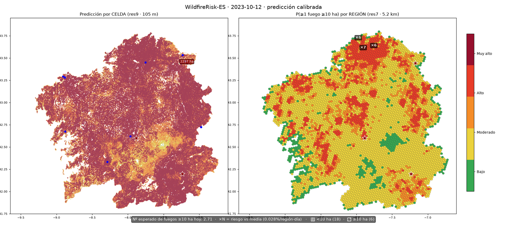

# WildfireRisk-ES (codename: Ardentia)

Explainable predictive system for forest-fire **ignition risk** over Galicia
(Spain), at H3 hexagon res9 (~105 m per cell), driven by a day-ahead weather
forecast so it can actually run operationally.

> Detailed documentation in [`docs/`](docs/):
> - [PREPROCESSING.md](docs/PREPROCESSING.md) — full preprocessing pipeline (sources → features → model)
> - [EXPERIMENTS.md](docs/EXPERIMENTS.md) — experiment log: what was adopted and what was refuted, with metrics
> - [DATA_MODEL.md](docs/DATA_MODEL.md) — data lake layout, features and labels
> - [PIPELINES.md](docs/PIPELINES.md) — operational guide: regenerate everything from scratch
> - [SOURCES.md](docs/SOURCES.md) — data sources, rate limits and quirks

## Why

Conventional fire-weather indices (FWI) are meteorological and coarse. This
system adds **three layers** that the FWI ignores:

1. **Static territory**: topography (Copernicus GLO-30), Rothermel fuel models
   (Spanish MFE25 forest map, `n_MODCOM` 1–13 directly available), and the
   **human factor** — road network (OSM) with `dist_to_road`, `road_class`,
   `road_density_1km` and `road_fuel_interface` (a road whose shoulder touches
   dense fuel).
2. **Biophysical dynamics**: Sentinel-2 summer composites (NDMI/NDVI/NBR) via
   **public STAC/AWS (no auth, no GEE)**; AEMET weather (real time) +
   Open-Meteo historical backfill; ERA5-Land soil moisture and VPD.
3. **Explainability**: per-cell TreeSHAP factors + an operational daily
   bulletin (optionally written in prose by a local LLM).

**Validation criterion (Phase-2 gate):** the pilot model must beat a
pure-FWI baseline on **PR-AUC**, with ablations isolating the contribution of
the road/human variables. Result: **GO** — 21–24× lift over chance vs 0.6×
for FWI-only (see [`reports/gate_report.md`](reports/gate_report.md)).

## Quick start

```bash
uv sync && uv pip install osmium
cp .env.example .env   # fill in keys (see docs/SOURCES.md)
.venv/bin/python -m ardintra.ingest.bootstrap_data --sources egif,effis,dem,osm,mfe25
```

Individual pipelines (`uv run python -m <module>`):

| Module | What it does |
|---|---|
| `ardintra.ingest.egif.parse_egif` | EGIF XML/zip → `parts_normalized.parquet` + QA |
| `ardintra.ingest.effis_wfs` | RDII perimeters 2017–2025 via WFS (no auth) |
| `ardintra.ingest.dem_glo30` | Copernicus GLO-30 → mosaic + slope + aspect |
| `ardintra.ingest.osm_roads` | OSM pbf → `roads_driveable.parquet` (normalized classes) |
| `ardintra.ingest.mfe25` | MFE25 → SHP (Rothermel fuel model per polygon) |
| `ardintra.ingest.aemet.aemet_obs` | AEMET hourly obs + stations (real time) |
| `ardintra.ingest.openmeteo_daily` | Weather historical backfill (idempotent checkpoints) |
| `ardintra.ingest.openmeteo_forecast_daily` | Day-D weather forecast issued D-1 (operational regime) |
| `ardintra.ingest.s2_stac` | LOCAL S2 composites (NDMI/NDVI/NBR summers 2017–2024 @100 m, no auth) |
| `ardintra.features.build_static` | Master H3 res9 static table |

## Validated production pipeline (2026-10-31)

```
Day-D forecast (HRES via Open-Meteo, per-station NGR-lite bias correction)
  → LGBM 48 features (245k H3 res9 cells)
  → isotonic calibration (Brier 0.0118→0.0065, near-perfect reliability)
  → regional Stage 2: GLM + Moran Eigenvector Maps res7 (hierarchical Poisson)
  → risk levels ×N + daily λ (expected number of ≥10 ha fires)
```

**Key metrics** (honest temporal splits; 2023-24 test data never used in
training or any modeling decision):

| Metric | Value | Reference |
|---|---|---|
| Aggregate ROC-AUC (sample, obs weather) | 0.897 | LGBM 48 feats |
| Aggregate ROC-AUC (day-D forecast, NGR-corrected) | 0.887 | −1pp cost of operating on forecasts |
| Operational recall top-10% of territory | 29.5-31.2% | 82 test days, 137 fires ≥10 ha |
| Operational recall top-5% | 13-14% | idem |
| Regional AUC (Stage 2 GLM+MEM, 2024) | **0.755** | vs 0.693 isotonic / 0.719 raw |
| Recall@10% region-days (Stage 2) | **39.4%** | vs 27.3% baseline |
| Cell calibration (Brier) | 0.0065 | −45% vs raw |
| Forecast NGR correction | FWI RMSE −22% | 3.03→2.37 |

**Example video** (`reports/simulacion_2023_2panel.mp4`, 2023 season):
left = res9 cells by risk percentile; right = P(≥1 fire ≥10 ha) per res7
region with the Stage 2 model, ×N labels (risk vs base rate) on the day's
top regions; footer with daily λ and real fires (⭐ ≥10 ha).

## Interactive webapp (real predictions, pick a day)

```bash
uv run uvicorn ardintra.api.mini_api:app --port 8001
# open http://localhost:8001
```

The MapLibre viewer runs the **real production system**: pick a date →
"Predecir" → builds the 245,172-cell feature matrix (day-D forecast, satellite,
fire recency, roads) → per-cell P(ignition ≥10 ha) calibrated; per-region
P(≥1 fire ≥10 ha) (Stage 2 GLM+MEM); daily λ; and the real EGIF fires of that
day drawn on top for comparison.

- **TreeSHAP explainability**: click any cell (with a prediction active) →
  the factors pushing its score up/down (log-odds, original values).
  (`GET /v1/explain/{date}/{h9}`)
- **Daily bulletin** (📋): λ, highlighted regions ×N, day-level global factors
  (mean |SHAP|) and comparison with real fires. **Written in prose by a local
  LLM** if available; deterministic summary otherwise.

```bash
# 1) local lightweight LLM (first run creates .venv-llm with vLLM; GPU ≥12 GB)
bash scripts/serve_llm.sh
# 2) viewer with the backend connected (prose bulletin; server/model swappable by env)
LLM_BASE_URL=http://localhost:8002/v1 uv run uvicorn ardintra.api.mini_api:app --port 8001
```

The bulletin backend is fully swappable via env: `LLM_BASE_URL` (with
`LLM_MODEL` auto-discovered from `/models`, and optional `LLM_API_KEY`) —
works with vLLM, ollama, llama.cpp or LM Studio without code changes; the
Anthropic API also works via `ANTHROPIC_API_KEY`.

- Endpoints: `GET /v1/forecast/{date}`, `GET /overlay/forecast/{date}.png`,
  `GET /v1/explain/{date}/{h9}`, `GET /v1/bulletin/{date}`.

## Visual results

**2023 season with the full system** (`reports/simulacion_2023_2panel.mp4`,
2 panels: res9 cells + res7 regions with P(≥1) and ×N labels; footer with
daily λ and real fires ⭐):

| Peak day (Oct 12 2023, 6 fires ≥10 ha) | Season start |
|---|---|
|  |  |

Cycle charts: [ROC/PR curves](reports/figures/curvas_roc_pr.png) ·
[ablation](reports/figures/ablacion.png) ·
[resolutions](reports/figures/resoluciones.png). More per-resolution videos:
`reports/simulacion_2023_res{4..9}.mp4`.

## Lessons from the experimentation cycle (2026-10-30/31)

Refutations (all documented with numbers in
[`reports/FULLGRID_REGIONAL.md`](reports/FULLGRID_REGIONAL.md)):

- **The sample→full-grid gap is THE central problem**: calibration fitted on
  the sampled training distribution does not transfer to the full 245k-cell
  grid (structural overconfidence). TabPFN v2 (sampled AUC 0.9387, +5.1pp over
  LGBM) also fails to transfer via distillation (top-10% recall 18% vs 29.5%)
  — teacher out-of-distribution failure. Replicated with NVIDIA Kumo Tabular.
- Stratified negative sampling (Pourmohamad 2025): hurts here (−1.9pp AUC).
- 14-day temporal sequences (LSTM/flat/summaries): no gain — FWI indices are
  already temporal integrators (DC/DMC accumulate months of memory).
- Cause-separated models: −3.6pp (76% human ignitions dominate the pattern).
- WUI/building-density from OSM: collinear with existing road features.
- NB frailty (spatial dependence): fails out-of-sample (55 training days).

Adopted: isotonic calibration (Brier −45%), Stage 2 GLM+MEM (+12pp regional
recall@10%), NGR forecast correction (RMSE −22%, removes the operational
data-leak).

## Status (2026-10-31)

- Full pipeline operational: D-1 forecast → LGBM → isotonic → Stage 2 → video ✔
- Data: EGIF+EFFIS (cause propagated), AEMET+Open-Meteo (obs and D-1 forecast),
  ERA5-Land, S2 8/8 summers, OSM (roads + buildings), DEM/MFE25 ✔
- Open: cause-separated models with more data, ECMWF 51-member ensembles,
  more historical years (the real limit is signal, not model class)

## Hexagon resolution comparison (balanced-ensemble 25×, target ≥10 ha, test 2023-24)

| res | cell | rows | big10 test prevalence | PR-AUC | **lift** | ROC-AUC | recall@5% |
|---|---|---|---|---|---|---|---|
| **res9** | 105 m | 267k | 0.23% | 0.0538 | **23.4×** | **0.9179** | 54% |
| **res8** | 740 m | 72k | 0.82% | 0.1247 | 15.2× | 0.9021 | 51% |
| res7 | 5.2 km | 28k | 2.38% | 0.1451 | 6× | 0.8643 | 36% |
| res6 | 36 km² | 30k | 2.04% | 0.1336 | 7× | 0.8737 | 39% |
| res5 | 253 km² | 16k | 4.07% | 0.1622 | 4× | 0.8488 | 29% |
| res4 | 1,770 km² | 11k | 5.11% | 0.2656 | 5× | 0.8757 | 30% |

⚠️ Absolute AP rises with larger cells ONLY because prevalence rises; the
**honest lift** shows res9/res8 are far superior (5-21× vs 4-7×).
